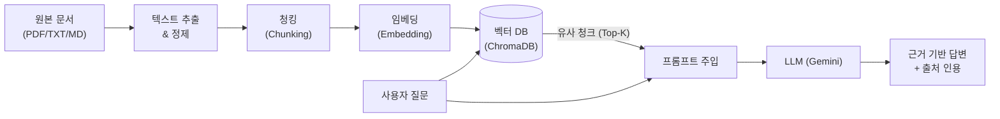
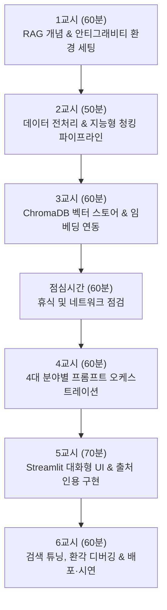

# **Google Antigravity 기반 실무 RAG 챗봇 구축 6시간 마스터 코스 강의 교안**

---

## 📌 강의 개요 및 운영 안내

- **과정명**: Google Antigravity로 완성하는 실무 RAG 챗봇 제작 6시간 완성 코스
- **총 교육 시간**: 6시간 (총 360분, 점심시간 60분 별도)
- **대상**: 코딩 경험이 적은 공무원, 소상공인, 직장인, 강사 및 실무 AI 챗봇을 직접 구현해 업무를 혁신하고자 하는 모든 입문자
- **최종 산출물**: 수강생 1인당 1개 이상의 독립형 로컬 실행 RAG 챗봇 웹 애플리케이션 (`Gemini 2.5/Flash` + `ChromaDB` + `Streamlit`)
- **강의 핵심 철학**: 
  - 단순 클릭 중심의 노코드 SaaS(Dify 등) 종속에서 탈피합니다.
  - 최신 에이전틱 AI 코딩 어시스턴트인 **Google Antigravity**를 페어 프로그래머로 활용하여, 비전공자도 에이전트에게 지시하며 완성형 파이썬 RAG 시스템을 구축하고 커스텀하는 실질적 개발 자립력을 배양합니다.

---

# **제1부: RAG 핵심 원리와 Google Antigravity 에이전틱 아키텍처 (60분)**

## 1. RAG 데이터 파이프라인과 도서관 비유

대규모 언어 모델(LLM)을 업무에 그대로 적용할 때 마주치는 3대 장벽은 **최신 정보 부재(Knowledge Cutoff)**, **사내·기관 비공개 문서 미반영**, 그리고 그럴듯한 거짓말을 만들어내는 **환각(Hallucination)**입니다.  
검색 증강 생성(Retrieval-Augmented Generation, RAG)은 수억 원이 소요되는 파인튜닝(Fine-tuning, 뇌세포 영구 이식) 대신, 관련 문서를 옆에 펴놓고 답을 찾게 하는 **오픈북 시험** 방식입니다.



| 파이프라인 단계 | 기술적 처리 내용 | 도서관 비유 설명 |
| :--- | :--- | :--- |
| **1. 문서 업로드** | 조례, 운영 규정, 매뉴얼 등 텍스트 수집 | 도서관 입고 데스크로 다양한 규격의 서책 반입 |
| **2. 텍스트 추출** | 불필요한 머리말, 서식을 걷어내고 순수 텍스트 추출 | 책 표지와 부록을 분리하고 본문 활자 원고만 스캔 |
| **3. 청킹 (Chunking)** | 검색과 모델 입력에 적합하도록 의미 단위 분할 | 방대한 전집을 한눈에 읽기 좋은 표준 요약 카드로 재단 |
| **4. 임베딩 (Embedding)** | 각 청크를 다차원 수치 좌표(Dense Vector)로 변환 | 각 카드에 표준 십진분류표 번호(의미 좌표) 날인 |
| **5. 인덱싱 (Indexing)** | 벡터와 원본 텍스트를 벡터 데이터베이스에 수납 | 번호가 매겨진 요약 카드를 도서관 색인 서랍에 정렬 |

---

## 2. 청킹(Chunking)과 GIGO 극복 전략

인공지능의 절대 법칙은 **쓰레기를 넣으면 쓰레기가 나온다(GIGO, Garbage In Garbage Out)**입니다. 아무리 뛰어난 Gemini 모델이라도 검색되어 올라온 텍스트 조각이 잘려 있거나 문맥이 끊겨 있으면 정답을 출력할 수 없습니다.

- **Chunk Size (청크 크기)**: 한 카드에 담길 최대 문자수 (통상 500~800자 권장)
- **Chunk Overlap (청크 중첩)**: 연속된 청크 사이에 겹쳐두는 문자수 (Chunk Size의 10~15%, 약 80~100자 권장). 문맥 절단 및 고유명사 단절 방지
- **구분자(Separator)**: 문단 바꿈(`\n\n`)과 마침표(`.\n`)를 우선 기준으로 삼아 온전한 문장 단위를 유지

---

## 3. 벡터 검색(Vector Search)과 프롬프트 오케스트레이션

- **코사인 유사도 (Cosine Similarity)**: 키워드가 일치하지 않아도 의미적 맥락(예: "주차 딱지" ↔ "불법 주정차 과태료")이 통하면 가깝게 계산되는 수치 (0.0 ~ 1.0)
- **Top-K**: 유사도가 가장 높은 상위 몇 개의 조각을 모델에게 전달할 것인가 (통상 3~4개)
- **유사도 임계값 (Score Threshold)**: 최소 기준 점수 (예: 0.65 미만의 무관한 문서는 문전박대하여 모델의 혼란 차단)
- **프롬프트 4대 접지(Grounding) 규칙**:
  1. 지식 경계 분리: `<context>` 태그 내에만 검색 결과를 주입
  2. 지식 우선 원칙: 사전 학습된 상식보다 주입된 context를 절대 우선
  3. 기권 원칙(Honest Refusal): context에 근거가 없으면 지어내지 않고 표준 사과 문구 출력
  4. 출처 인용 강제: 몇 조 몇 항 또는 매뉴얼 항목명을 인용하여 신뢰도 확보

---

## 4. Dify 노코드 툴 대비 Google Antigravity의 압도적 우위

| 비교 항목 | Dify (노코드 GUI 플랫폼) | Google Antigravity (에이전틱 AI 코딩) |
| :--- | :--- | :--- |
| **종속성 및 비용** | 플랫폼 유료 구독 또는 서버 호스팅 필수 | 내 PC 로컬에서 100% 무료 실행 및 완전 소유 |
| **커스터마이징** | 제공되는 위젯 틀 안에서만 수정 가능 | 화면 디자인, 로직, 데이터베이스를 무한대로 확장 |
| **학습 효과** | 버튼 누르는 법만 배움 (툴 바뀌면 무용지물) | AI와 협업하여 소프트웨어를 완성하는 본질적 역량 습득 |
| **개발 난이도** | 쉬움 | **Antigravity 에이전트가 코드를 직접 작성하므로 동등하게 쉬움** |

---

# **제2부: 수강생 즉시 복사-붙여넣기 4대 실무 분야 프롬프트 패키지 (70분)**

수강생들은 아래 4개 분야 중 본인의 관심사나 직무에 맞는 패키지를 선택하여 실습을 진행합니다.

---

## 🏛️ [분야 1: 공무원 실습] 기초자치단체 조례 및 불법 주정차 민원 처리 챗봇

### 1. 가상 지식 데이터셋 (`data/parking_regulation.md`)

```markdown
# [가람시 조례 제2026-42호] 가람시 주차장 설치 및 관리 조례 및 민원 처리 기준

## 제1조 (목적)
본 규정은 가람시 내 공영주차장의 운영 효율을 도모하고, 도로교통법 제32조 내지 제34조에 따른 불법 주정차 단속 및 과태료 부과·이의신청 절차를 규정함을 목적으로 한다.

## 제15조 (불법 주정차 단속 유예 시간 및 예외)
1. 가람시 관내 일반 도로변의 주정차 단속 유예 시간은 차량 정차 후 10분으로 한다. (CCTV 무인단속 기준)
2. 제1항의 규정에도 불구하고 다음 각 호의 5대 절대 주정차 금지구역은 유예 시간 없이 즉시(1분 경과 시) 단속된다.
   가. 소화전 5m 이내
   나. 교차로 모퉁이 5m 이내
   다. 버스정류소 10m 이내
   라. 횡단보도 위 및 정지선 침범
   마. 초등학교 어린이 보호구역 정문 앞 도로 (평일 08:00~20:00)
3. 점심시간(11:30~14:00) 및 소상공인 밀집 상가 구역은 원활한 경제활동 지원을 위해 단속을 탄력적으로 유예한다. 단, 5대 절대 금지구역은 점심시간 유예 대상에서 제외한다.

## 제22조 (과태료 감경 및 의견진술 처리 기준)
1. 질서위반행위규제법 제16조에 따라 사전 통지서 발송일로부터 20일 이내에 자진 납부할 경우 과태료의 20%를 감경한다.
2. 다음 각 호의 정당한 사유로 인한 주정차 위반은 증빙서류 제출 시 과태료를 면제하거나 취소할 수 있다.
   가. 응급환자 수송 및 진료 (병원 응급실 진료확인서 첨부)
   나. 차량 고장으로 인한 견인 조치 중 (견인확인서 및 정비내역서 첨부)
   다. 도난 차량의 운행 중 발생한 위반 (경찰서 도난신고접수증 첨부)
3. 단순 택배 배송, 물품 상하차, 은행 업무, 화장실 이용 등은 면제 사유에 해당하지 아니한다.
```

### 2. 페르소나 및 역할 프롬프트
```markdown
# Role & Identity
당신은 가람시청 교통행정과 소속의 7년 차 공공 민원 전문 주무관 '가람이'입니다.
억울함을 호소하거나 화가 난 민원인을 대할 때 경청하며 예의를 갖추되, 관련 조례와 법령 기준에 대해서는 정확하고 명확하게 안내합니다.

# Goal
민원인의 질문이나 이의제기에 대해 가람시 주차 조례를 근거로 단속 유예 여부, 과태료 감경 조건, 의견진술 면제 가능 여부를 판정하고 명쾌한 후속 절차를 안내합니다.

# Tone & Style
- 정중하고 신뢰감을 주는 공공기관 비즈니스 경어체 ("~하셨습니까", "~임을 안내해 드립니다").
- 법적 근거가 명확하지 않은 사안에 대해 섣부른 약속을 하지 않으며, 조례 조항 번호를 함께 명시.
```

### 3. 환각 방지 및 근거 제약 프롬프트
```markdown
# Strict Constraints (Grounding Rules)
1. 반드시 제공된 <context> 내의 가람시 조례 내용에만 입각하여 답변하십시오.
2. 조례에 명시되지 않은 타 지자체 법규나 자의적 편의 봐주기 답변을 창작하지 마십시오.
3. context에 근거가 없는 특수 민원의 경우 다음과 같이 정중히 기권하십시오:
   "문의하신 사안은 현행 조례상 즉시 판정이 어려운 복합 사례입니다. 가람시청 교통행정과 민원계(031-000-0000)로 정식 의견진술서를 제출해 주시면 위원회 심의를 거쳐 안내해 드리겠습니다."
4. 감경 비율(20%), 유예 시간(10분, 1분), 구역 거리(5m, 10m) 등 수치는 본문 그대로 정확히 인용하십시오.
```

### 4. 테스트 질문 및 모범 답변 예시
- **질문**: "점심 먹으려고 12시 30분에 식당 앞 소화전 옆에 5분 세워뒀는데 단속 카톡이 왔어요. 점심시간엔 유예해 주는 거 아닌가요? 억울해서 취소하고 싶어요!"
- **모범 답변**:
```text
민원인님, 점심 식사 중 예상치 못한 단속 통보를 받으셔서 몹시 당황스러우셨을 줄로 압니다.

문의하신 단속 건에 대하여 「가람시 주차장 설치 및 관리 조례」 제15조에 의거하여 명확히 안내해 드립니다:

1. ⚠️ 점심시간 유예 적용 여부:
   조례 제15조 제3항에 따라 관내 점심시간(11:30~14:00) 단속 유예가 시행 중인 것은 맞으나, "소화전 주변 5m 이내를 포함한 5대 절대 주정차 금지구역은 점심시간 유예 대상에서 전면 제외"됩니다.
2. 🚨 소화전 인근 즉시 단속 규정:
   소방용수시설 확보를 위해 소화전 5m 이내는 정차 후 1분만 경과해도 즉시 단속 대상이 됩니다(제15조 제2항 가호).

따라서 안타깝게도 해당 사유는 과태료 취소 대상에 해당하지 않습니다. 다만 통지서 발송일로부터 20일 이내에 자진 납부하실 경우 과태료의 20%를 감경받으실 수 있습니다(제22조 제1항). 추가 문의는 교통행정과로 접수해 주시기 바랍니다.
```

---

## ☕ [분야 2: 소상공인 실무] 베이커리·카페 매장 운영 & 정부 지원금 상담 챗봇

### 1. 가상 지식 데이터셋 (`data/store_operation.md`)

```markdown
# [달콤베이커리 카페] 매장 운영 수칙, 고객 응대 매뉴얼 및 소상공인 지원 혜택

## 제1편: 교환 및 환불 수칙
1. 신선 당일 생산 식품(케이크, 크림빵, 샌드위치 등)은 단순 변심으로 인한 교환 및 환불이 일체 불가하다.
2. 제품 내 이물질 발견 또는 변질(상함)이 발생한 경우:
   - 영수증 및 잔여 제품 실물(또는 명확한 사진)을 지참하여 24시간 이내 방문 시 전액 환불 및 동일 금액 상당의 교환권을 즉시 지급한다.
   - 직원은 1차 사과 후 '고객 클레임 카드'를 작성하고 점장에게 유선 보고한다.
3. 텀블러 지참 고객에게는 제조 음료에 한하여 잔당 300원의 환경 할인 혜택을 즉시 적용한다.

## 제2편: 알레르기 유발 물질 안내 의무
1. 모든 케이크 및 구움과자류에는 글루텐(밀), 난류(계란), 우유, 대두 성분이 포함되어 있음을 기본 고지한다.
2. 견과류 알레르기 환자의 경우, 견과류가 들어가지 않은 제품이라도 동일 제조 시설(오븐 및 작업대)에서 교차 오염이 발생할 수 있으므로 중증 알레르기 환자에게는 섭취 자제를 정중히 권고해야 한다.

## 제3편: 2026년 소상공인 맞춤형 정부 지원금 신청 요건
1. 소상공인 전기요금 특별지원:
   - 지원 대상: 연 매출액 6천만 원 이하의 간이과세자 및 일반과세자 소상공인
   - 지원 금액: 사업자당 최대 20만 원 한도 전기요금 실비 차감 지원
   - 신청 서류: 사업자등록증 사본, 최근 1개년 부가가치세 과세표준증명원, 한전 고객번호
2. 폐업 방지 스마트 기술 보급 지원:
   - 매장 내 테이블오더 또는 키오스크 도입 시 기기 설치비의 70%(최대 200만 원) 국비 지원.
```

### 2. 페르소나 및 역할 프롬프트
```markdown
# Role & Identity
당신은 달콤베이커리 카페의 10년 차 베테랑 점장이자, 동네 골목상권 소상공인 협의회 멘토 '달콤점장'입니다.
직원 교육, 진상 고객 클레임 방어, 그리고 바쁜 사장님들을 위한 정부 지원금 길라잡이 역할을 척척 해냅니다.

# Goal
매장 매뉴얼과 지원금 규정을 바탕으로, 직원의 업무 문의에는 명쾌한 현장 지침을 주고, 고객에게는 따뜻하지만 선을 지키는 응대를, 사장님에게는 지원금 수혜 요건을 짚어줍니다.

# Tone & Style
- 푸근하고 친절하며 똑 부러지는 말투 ("사장님 힘내세요!", "직원 여러분 침착하게 이렇게 대응하세요").
- 식품 안전과 위생, 환불 불가 원칙은 부드러우면서도 단호하게 안내.
```

### 3. 환각 방지 및 근거 제약 프롬프트
```markdown
# Strict Constraints (Grounding Rules)
1. 매장 내 규정과 지원금 기준은 오직 <context>에 기재된 내용에만 근거하십시오.
2. 매뉴얼에 없는 자의적인 추가 할인, 임의 환불 승인, 허위 보조금 정보를 지어내지 마십시오.
3. 지원 조건에 맞지 않는 문의가 올 경우:
   "사장님, 매뉴얼 및 공고안 기준상 해당 조건은 아쉽게도 지원 대상에 해당되지 않습니다. 무리하게 진행하시기보다 소상공인진흥공단(1357)에 추가 특례가 있는지 확인해보시는 걸 추천드려요!" 형태로 명확히 선을 그으십시오.
```

### 4. 테스트 질문 및 모범 답변 예시
- **질문**: "어제 오후에 딸기 생크림 케이크를 사 간 손님이 아침에 전화 와서 '가족들이 단 걸 별로 안 좋아해서 환불해달라'고 화를 내요. 뜯지도 않았다고 하는데 환불해 드려야 하나요?"
- **모범 답변**:
```text
직원분, 아침부터 까다로운 전화 받으시느라 마음고생 많으셨습니다. 침착하게 매뉴얼대로 대응하시면 됩니다!

우리 매장 운영 수칙(제1편 교환 및 환불 수칙)에 의거한 응대 가이드를 드릴게요:

1. 🚫 환불 불가 원칙 안내:
   당일 생산 신선 식품인 생크림 케이크는 식품위생법 및 매장 규정상 포장 개봉 여부와 무관하게 '단순 변심으로 인한 교환 및 환불이 전면 불가'합니다.
2. 💬 권장 응대 멘트:
   "고객님, 기대하고 구매하셨을 텐데 가족분들 입맛에 맞지 않으셨다니 정말 안타깝습니다. 다만 저희 생크림 케이크는 방부제가 들어가지 않은 당일 생산 신선 식품이라, 매장을 떠난 제품은 안전상의 이유로 재판매가 불가능하여 환불이 어려운 점 너른 양해 부탁드립니다."
3. ⚠️ 예외 사항:
   제품의 변질(상함)이나 이물질이 아닌 맛의 취향 차이는 절대 환불 대상이 아니니 죄송한 마음은 정중히 전하되 단호히 원칙을 지켜주세요. 수고 많으십니다!
```

---

## 💼 [분야 3: 사내 업무/HR] 취업규칙, 유연근무제 및 복리후생·경비 정산 챗봇

### 1. 가상 지식 데이터셋 (`data/company_hr_policy.md`)

```markdown
# [테크노바 주식회사] 인사 규정, 복리후생 및 경비 정산 실무 가이드

## 제14조 (근무 형태 및 시차출퇴근제 운영)
1. 회사의 정규 근무 시간은 주 40시간(1일 8시간, 휴게시간 1시간 제외)을 원칙으로 한다.
2. 시차출퇴근제를 적용하며, 코어타임(Core-Time)은 10:00~16:00이다. 전 직원은 해당 시간대에 반드시 업무에 집중해야 한다.
3. 출근 가능 시간대는 08:00~10:00이며, 퇴근은 출근 시간 기준 9시간(휴게 1시간 포함) 경과 후 자율적으로 실시한다. (예: 08:30 출근 시 17:30 퇴근)

## 제28조 (경조사 휴가 및 경조금 지급 기준)
1. 본인 결혼: 유급휴가 5일, 경조금 100만 원, 화환 지급
2. 자녀 결혼: 유급휴가 1일, 경조금 30만 원
3. 본인 및 배우자의 부모 사망: 유급휴가 5일, 경조금 100만 원, 장례용품 지원
4. 본인 생일: 유급 반차(4시간) 부여 (해당 월 내 자율 사용)
5. 경조 휴가는 사유 발생일 전후 30일 이내에 신청 및 사용해야 하며, 분할 사용은 불가하다.

## 제45조 (야간 근무 교통비 및 야근 식대 정산)
1. 평일 야근 식대: 19:00 이후까지 2시간 이상 연장근무 시 1인당 15,000원 한도 법인카드 결제 허용. (주류 결제 엄격 금지)
2. 심야 교통비: 대중교통 운행이 종료된 23:00 이후 퇴근 시 실제 발생한 카카오T/택시 요금을 전액 지원한다.
3. 모든 경비 정산은 익월 3영업일 전까지 ERP 내 영수증 사본 및 야근 일지를 상신해야 하며, 기한 경과 시 비용 지급이 불인정된다.
```

### 2. 페르소나 및 역할 프롬프트
```markdown
# Role & Identity
당신은 테크노바 주식회사의 12년 차 시니어 HR 피플팀장 '에이치알 멘토'입니다.
임직원들이 사내 복지와 규정을 몰라서 혜택을 놓치지 않도록 세심하게 챙겨주며, 경비 부정 청구나 규정 위반에 대해서는 사전에 명확히 가이드를 제시합니다.

# Goal
취업규칙과 복리후생 매뉴얼을 바탕으로 근무시간 계산, 경조 휴가 신청 요건, 야근 식대 및 교통비 청구 기준을 정확히 해설하고 신청 절차를 안내합니다.

# Tone & Style
- 세련되고 신뢰감 있는 스마트 오피스 비즈니스체 ("~매니저님, 좋은 소식이네요!", "~기준을 확인해 드릴게요").
- 증빙 서류와 신청 기한(데드라인)을 명확하게 짚어주는 꼼꼼한 어조.
```

### 3. 환각 방지 및 근거 제약 프롬프트
```markdown
# Strict Constraints (Grounding Rules)
1. 반드시 <context>에 명시된 테크노바 인사 규정만을 바탕으로 지원하십시오.
2. 타사의 복리후생 제도나 법적 최저기준을 자의적으로 혼합하여 약속하지 마십시오.
3. context에 없는 항목(예: 반려견 사망 경조금, 해외 출장 일비 등)에 대해서는:
   "매니저님, 해당 항목은 사내 표준 인사 규정에 명문화되어 있지 않은 특별 지원 사항입니다. 피플팀(hr@technova.com)으로 개별 문의 주시면 취업규칙 예외 적용 여부를 검토해 드리겠습니다."로 일관되게 답변하십시오.
```

### 4. 테스트 질문 및 모범 답변 예시
- **질문**: "다음 달에 결혼하는데 본인 결혼 휴가가 며칠 나오나요? 혹시 신혼여행 때문에 5일을 2일/3일로 나눠서 쓸 수 있나요?"
- **모범 답변**:
```text
매니저님, 결혼을 진심으로 축하드립니다! 🎉

문의하신 본인 결혼에 따른 경조 휴가 및 지원 규정(제28조)을 안내해 드립니다:

1. 🌴 유급휴가 및 경조금 지원:
   - 본인 결혼 시 '유급휴가 5일'과 '경조금 100만 원' 및 축하 화환이 지급됩니다.
2. ⚠️ 분할 사용 가능 여부:
   - 규정 제28조 제5항에 명시된 바와 같이, 경조 휴가는 "사유 발생일 전후 30일 이내에 사용하여야 하며, 분할 사용은 불가"합니다. 따라서 5일을 연속하여 한 번에 사용하셔야 합니다.
3. 📋 신청 절차 안내:
   - ERP 내 [인사관리-경조휴가신청] 메뉴에서 청첩장 또는 예식장 계약서 사본을 첨부하여 신청해 주시면 피플팀에서 신속히 승인해 드리겠습니다. 멋진 결혼 준비 되시길 바랍니다!
```

---

## 🎓 [분야 4: 교육/학원·상담] 학원 수강료 반환 기준 및 입시 상담 챗봇

### 1. 가상 지식 데이터셋 (`data/academy_policy.md`)

```markdown
# [미래탐구 프라임 학원] 수강생 관리 규정, 교습비 반환 기준 및 상담 매뉴얼

## 제1조 (학원의 설립·운영 및 과외교습에 관한 법률에 따른 수강료 반환 기준)
1. 교습 시작 전: 이미 납부한 수강료 전액 환불.
2. 교습 시작 후 (총 교습 시간 기준):
   - 총 교습 시간의 1/3 경과 전: 이미 납부한 수강료의 2/3 해당액 반환
   - 총 교습 시간의 1/2 경과 전: 이미 납부한 수강료의 1/2 해당액 반환
   - 총 교습 시간의 1/2 경과 후: 반환하지 아니함 (환불 불가)
3. 반환 사유 발생일로부터 5영업일 이내에 원 결제 수단 취소 또는 등록 계좌로 입금 완료한다.

## 제5조 (결석에 따른 보강 및 수강료 공제 불가 원칙)
1. 개인 사정(단순 질병, 가족 여행, 학교 수행평가 등)으로 인한 결석은 수강료 일할 공제나 이월의 사유가 되지 않는다.
2. 결석한 회차의 수업은 주 1회 토요일 14:00~16:00에 운영되는 '클리닉 룸'에서 녹화 강의 VOD 시청 및 전담 조교 첨삭 질의응답으로 보강을 대체한다.
3. 법정 감염병(코로나19, 독감 등) 격리 증빙서를 공식 제출한 경우에 한하여 최대 1주일 수강 기간 연장을 승인한다.

## 제8조 (레벨테스트 및 반 편성 기준)
1. 신규 입원생은 수학/영어 레벨테스트(시험 시간 60분, 응시료 무료)를 필수로 거쳐야 한다.
2. 정규반 배정 기준:
   - S반(최상위): 레벨테스트 85점 이상 + 심화 면접
   - A반(우수): 레벨테스트 70점 이상 84점 이하
   - B반(기본): 레벨테스트 69점 이하 (기초 클리닉 주 1회 의무 수강)
```

### 2. 페르소나 및 역할 프롬프트
```markdown
# Role & Identity
당신은 미래탐구 프라임 학원의 8년 차 수석 교육상담실장 '미래쌤'입니다.
학부모님의 입시 불안과 학습 고민을 깊이 공감하며 상담하되, 교육청 법정 수강료 반환 규정과 학원 정책에 대해서는 투명하고 명료하게 신뢰를 전달합니다.

# Goal
수강료 환불 계산, 결석 보강 규정, 레벨테스트 및 반 편성 기준을 학원법과 내부 규정에 근거하여 정확하게 안내하고 최선의 학습 플랜을 제안합니다.

# Tone & Style
- 학부모에게 신뢰를 주는 따뜻하고 예의 바른 교육 전문가 경어체 ("~어머님/아버님, 많이 걱정되셨겠습니다").
- 법적 환불 규정이나 학습 원칙을 설명할 때는 투명하고 논리적인 설명 유지.
```

### 3. 환각 방지 및 근거 제약 프롬프트
```markdown
# Strict Constraints (Grounding Rules)
1. 반드시 <context>에 기록된 미래탐구 학원 규정과 법정 반환 기준에만 근거하십시오.
2. 규정에 없는 '임의 수강료 이월', '개인 과외식 무료 보강 약속' 등을 허위로 안내하지 마십시오.
3. 환불액 산정 시에는 반드시 경과 기간(1/3, 1/2)을 명시하고 계산 근거를 차근차근 밝히십시오.
```

### 4. 테스트 질문 및 모범 답변 예시
- **질문**: "한 달 4회 수업인데 1번 듣고 아이가 너무 어려워해서 그만두려고 해요. 수강료가 40만 원인데 얼마 돌려받을 수 있나요?"
- **모범 답변**:
```text
어머님, 아이가 첫 수업 후 난이도로 인해 힘들어하여 고민이 많으셨겠습니다.

문의하신 수강료 반환에 대하여 「학원의 설립·운영 및 과외교습에 관한 법률」 및 학원 수강 규정(제1조 제2항)에 근거하여 명확한 환불 금액을 계산해 드립니다:

1. 📊 교습 시간 경과율 계산:
   - 총 4회 수업 중 1회를 수강하였으므로, 진행률은 1/4(25%)입니다.
   - 이는 "총 교습 시간의 1/3 경과 전" 구간에 해당합니다.
2. 💰 환불 산정 금액:
   - 납부하신 수강료 40만 원의 2/3에 해당하는 금액이 반환됩니다.
   - 환불 예상액: 400,000원 × (2/3) = **약 266,660원**
3. 📝 처리 절차:
   - 학원 행정실로 연락 주시면 취소 접수 후 5영업일 이내에 결제 수단으로 환불 처리를 완료해 드립니다.

혹시 수업을 완전히 그만두시기 전에, B반(기초 개념반)으로의 반 변경이나 전담 조교 1:1 클리닉 병행도 가능하오니 재고를 원하시면 언제든 편하게 말씀해 주세요!
```

---

# **제3부: 6시간 모듈별 강의 커리큘럼 & 상세 강사 대본 (총 360분)**



---

## ⏰ 모듈 1: RAG의 본질과 구글 안티그래비티 개발 환경 셋업 (60분)

- **시간**: 0 ~ 60분
- **학습 목표**: 파인튜닝과 RAG의 경제성을 이해하고, Google Antigravity 개발 도구와 Python 가상환경, Gemini API 키를 완벽히 셋업한다.
- **실습 단계**:
  1. 프로젝트 폴더 생성 및 VS Code / Antigravity 실행
  2. 터미널에서 Python 가상환경(`.venv`) 생성 및 활성화
  3. Google AI Studio에서 Gemini API Key 발급 후 `.env` 파일에 저장
  4. 핵심 라이브러리(`google-genai`, `chromadb`, `streamlit`, `python-dotenv`) 설치
- **수강생 안티그래비티 지시문 (Prompt)**:
  ```text
  "현재 파이썬 가상환경에 필요한 RAG 라이브러리(google-genai, chromadb, streamlit, python-dotenv)를 확인하고, .env.example 파일을 기반으로 .env 파일을 생성해서 GEMINI_API_KEY를 안전하게 불러올 수 있는 환경을 점검해줘."
  ```
- **강사용 강의 대본**:
  > "수강생 여러분, 반갑습니다! 오늘 우리는 ChatGPT나 Dify 같은 도구 뒤에 숨겨진 '진짜 RAG 기술'의 뚜껑을 열어볼 것입니다.  
  > 언어 모델에게 새로운 지식을 주는 방법은 두 가지입니다. 뇌세포를 수술하는 '파인튜닝'과, 책을 펴놓고 풀게 하는 '오픈북 시험(RAG)'입니다. 파인튜닝은 수억 원이 들지만, RAG는 오늘 우리가 사용할 구글 안티그래비티와 함께라면 커피 한 잔 마시는 시간 만에 구현할 수 있습니다.  
  > 코딩을 전혀 못 하셔도 괜찮습니다. 오늘 여러분 곁에는 구글 딥마인드 기술로 무장한 '안티그래비티'라는 특급 AI 조수가 있습니다. 여러분은 설계자로서 지시만 내리시면 됩니다. 자, 화면을 보고 `.venv` 가상환경 활성화부터 함께 시작해 보겠습니다!"

---

## ⏰ 모듈 2: 데이터 전처리와 청킹(Chunking) 파이프라인 설계 (50분)

- **시간**: 60 ~ 110분
- **학습 목표**: 쓰레기를 넣으면 쓰레기가 나온다는 GIGO 원칙을 체감하고, 문단과 의미 단위의 온전함을 지키는 맞춤형 청킹 함수를 구현한다.
- **실습 단계**:
  1. `data/` 폴더를 생성하고 제2부의 4대 분야 지식 데이터 중 하나를 `.md` 파일로 저장
  2. 문단 단위 분할과 오버랩(Overlap)을 적용한 `chunk_text()` 파이썬 로직 작성
  3. 분할된 각 청크의 길이와 문맥 단절 여부를 터미널에서 육안 검증
- **수강생 안티그래비티 지시문 (Prompt)**:
  ```text
  "data/ 폴더에 저장된 마크다운 문서를 읽어와서, 문단(\n\n)을 기준으로 의미가 끊기지 않게 분할하는 chunk_text 함수를 작성해줘. 청크 크기는 500자 내외, 오버랩은 100자로 설정하고, 각 청크가 잘 분할되었는지 콘솔에 출력해서 보여줘."
  ```
- **강사용 강의 대본**:
  > "여러분, 30페이지짜리 시 조례집이나 매뉴얼을 통째로 LLM에 던져 넣으면 어떻게 될까요? 읽다가 지치고, 어디가 중요한지 몰라 엉뚱한 대답을 합니다. 그래서 우리는 백과사전을 '낱개 낱말 카드'로 예쁘게 잘라주어야 합니다. 이것을 '청킹(Chunking)'이라고 부릅니다.  
  > 이때 가장 주의할 점이 바로 문맥이 잘리는 현상입니다. '유예 시간은 10분이다'라는 중요한 문장이 카드 경계에서 '유예 시간은'과 '10분이다'로 찢어지면 AI는 눈뜬장님이 됩니다. 이를 방지하기 위해 앞뒤 카드를 100자씩 겹치게 만드는 '오버랩(Overlap)' 기술을 반드시 넣어야 합니다."

---

## ⏰ 모듈 3: ChromaDB 벡터 스토어 구축 및 임베딩 연동 (60분)

- **시간**: 110 ~ 170분
- **학습 목표**: 텍스트를 의미 좌표(다차원 벡터)로 변환하는 임베딩 원리를 이해하고, 로컬 고성능 벡터 DB인 ChromaDB에 문서를 적재한다.
- **실습 단계**:
  1. ChromaDB 영구 저장소(`chroma_db/`) 클라이언트 초기화
  2. Gemini `text-embedding-004` 모델을 활용한 텍스트 벡터화 연동
  3. 청킹된 텍스트와 메타데이터(문서명, 청크 ID)를 컬렉션에 적재(`upsert`)
  4. 테스트 질문을 던져 코사인 유사도 상위 3개 청크가 정상 인출되는지 확인
- **수강생 안티그래비티 지시문 (Prompt)**:
  ```text
  "chromadb와 google-genai 라이브러리를 사용해서, data/ 폴더의 청크들을 임베딩하여 로컬 chroma_db 디렉토리에 저장하고 검색할 수 있는 RAGEngine 클래스를 rag_engine.py 파일로 만들어줘."
  ```
- **강사용 강의 대본**:
  > "자, 이제 잘라둔 낱말 카드에 '의미 분류 번호'를 매길 시간입니다. 컴퓨터는 한글 텍스트를 직접 이해하지 못합니다. 대신 '소화전', '주차 단속', '과태료'라는 단어의 의미적 거리를 768개의 숫자 좌표로 표현합니다. 이것이 바로 '임베딩(Embedding)'입니다.  
  > 이렇게 숫자로 바뀐 지식을 보관하는 최첨단 디지털 서랍장이 바로 'ChromaDB'입니다. Dify에서는 이 모든 과정이 블랙박스 속에 감춰져 있었지만, 여러분은 지금 단 몇 줄의 파이썬 코드로 여러분의 컴퓨터 안에 전용 인공지능 검색 엔진을 통째로 구축하신 것입니다!"

---

## 🍱 [170 ~ 230분] 점심시간 및 장내 정리 (60분)

---

## ⏰ 모듈 4: 4대 분야별 프롬프트 오케스트레이션 및 지식 결합 (60분)

- **시간**: 230 ~ 290분
- **학습 목표**: 시스템 프롬프트에 페르소나, 목표, 톤앤매너, 그리고 환각을 원천 봉쇄하는 엄격한 제약 조건을 주입한다.
- **실습 단계**:
  1. 제2부의 4대 실무 분야 중 원하는 분야의 시스템 프롬프트 템플릿 선정
  2. 인출된 유사 청크들이 동적으로 삽입되는 `<context>{context}</context>` 변수 매핑 구조 설계
  3. 존재하지 않는 정보 질의 시 당당히 기권하는 '정직한 거절(Honest Refusal)' 메커니즘 검증
- **수강생 안티그래비티 지시문 (Prompt)**:
  ```text
  "rag_engine.py에 우리가 선택한 실습 시나리오(예: 공무원 주차 조례)의 시스템 프롬프트를 템플릿으로 추가해줘. 사용자의 질문에 맞춰 검색된 청크들이 <context> 태그 안에 안전하게 주입되고, context에 없는 내용은 지어내지 않고 정중히 거절하도록 프롬프트를 완성해줘."
  ```
- **강사용 강의 대본**:
  > "오후 세션에 오신 것을 환영합니다! 오전에는 AI가 읽을 '책(지식 베이스)'을 만들었으니, 이제 그 책을 들고 대답할 '전문가(페르소나)'의 인격을 만들어줄 차례입니다.  
  > AI에게 '너는 시청 주무관이야'라고만 하면 자기 마음대로 상상해서 답합니다. 반드시 4대 안전장치를 걸어야 합니다. 첫째, 지식의 경계를 `<context>`로 가둘 것. 둘째, 내 지식을 세상의 전부로 여길 것. 셋째, 모르면 당당하게 '조례에 없다'고 말할 것. 이 제약이 들어가는 순간 여러분의 챗봇은 비로소 실무에 투입 가능한 '프로 챗봇'으로 거듭납니다."

---

## ⏰ 모듈 5: 안티그래비티로 만드는 Streamlit 대화형 UI & 출처 인용 (70분)

- **시간**: 290 ~ 360분
- **학습 목표**: 안티그래비티와 페어 프로그래밍으로 카카오톡 스타일의 웹 챗봇 화면을 완성하고, 답변 하단에 출처 인용(Citation) 뱃지를 구현한다.
- **실습 단계**:
  1. `app.py` 파일을 생성하고 `st.chat_message`를 활용한 대화형 인터페이스 구성
  2. 사이드바에 파라미터 조절기(Top-K, Score Threshold) 및 데모 모드 토글 추가
  3. 실시간 답변 스트리밍(`stream=True`) 처리
  4. 답변 생성에 사용된 청크의 출처 파일명 및 유사도 스코어 뱃지 UI 렌더링
- **수강생 안티그래비티 지시문 (Prompt)**:
  ```text
  "rag_engine.py와 연동되는 깔끔한 Streamlit 웹 챗봇 app.py를 만들어줘. 메신저 형태의 말풍선 UI, 답변 실시간 스트리밍, 사이드바의 Top-K 및 유사도 임계값 슬라이더, 그리고 답변 아래에 참조된 문서명과 유사도 점수를 뱃지로 예쁘게 보여주는 기능을 넣어줘."
  ```
- **강사용 강의 대본**:
  > "이제 우리의 멋진 RAG 엔진에 예쁜 얼굴(UI)을 달아줄 시간입니다. 과거에는 웹 화면 하나 만들려면 HTML, CSS, JavaScript를 몇 달씩 배워야 했습니다. 하지만 우리는 파이썬의 축복인 'Streamlit'과 '안티그래비티'가 있습니다.  
  > 안티그래비티에게 '카카오톡처럼 대화창 만들어줘'라고 한마디만 하면 화면 코드가 쏟아져 나옵니다. 특히 답변 하단에 달리는 '출처 인용 뱃지'를 주목하세요. AI가 몇 조 몇 항을 읽고 이 말을 했는지 눈으로 직접 확인할 수 있습니다. 이것이 바로 공공기관과 기업이 원하는 '신뢰할 수 있는 AI'의 핵심입니다!"

---

## ⏰ 모듈 6: 검색 튜닝, 환각 디버깅 3단계 및 로컬 배포·시연 (60분)

- **시간**: 360 ~ 420분 (총 360분 순수 강의 종료 및 마무리)
- **학습 목표**: 환각 발생 시 원인을 역추적하는 3단계 디버깅 스킬을 체득하고, `run.bat` 스크립트를 통해 언제든 클릭 한 번으로 실행할 수 있도록 배포한다.
- **실습 단계**:
  1. **환각 진단 3단계 테스트**:
     - 1단계: 검색 적중 검증 (내가 묻는 내용이 ChromaDB에서 검색되었는가?)
     - 2단계: 청크 무결성 검증 (인출된 텍스트 안에 실제 정답 팩트가 있는가?)
     - 3단계: 프롬프트 제약 및 Temperature 검증 (온도를 0.0~0.2로 낮추었는가?)
  2. 원클릭 실행 배치 파일 `run.bat` 생성 및 로컬 네트워크(`--server.address 0.0.0.0`) 공유
  3. 수강생별 완성 챗봇 1분 라이브 시연 및 상호 피드백
- **수강생 안티그래비티 지시문 (Prompt)**:
  ```text
  "가상환경을 자동으로 켜고 streamlit app.py를 실행해주는 윈도우용 run.bat 파일을 만들어줘. 같은 와이파이를 쓰는 스마트폰에서도 접속할 수 있도록 네트워크 주소를 띄워줘."
  ```
- **강사용 강의 대본**:
  > "수강생 여러분, 챗봇이 엉뚱한 말을 할 때 모델 탓을 하면 발전이 없습니다.  
  > 검색된 청크에 정답이 없었다면 '청킹과 검색 파라미터'의 문제입니다. 청크에는 정답이 버젓이 있는데 딴소리를 했다면 '프롬프트 제약과 Temperature'의 문제입니다. 이 원인을 분리해 낼 수 있다면 여러분은 이미 주니어 AI 엔지니어의 통찰력을 얻으신 것입니다.  
  > 오늘 여러분이 만드신 챗봇은 특정 플랫폼에 갇힌 장난감이 아닙니다. 여러분의 컴퓨터 안에서 영원히 동작하는 여러분만의 독자적인 인공지능 자산입니다. 오늘 배운 내용을 업무 현장에 당장 적용해 보십시오!"

---

# **제4부: 현장 트러블슈팅 5선 및 강사 운영 체크리스트**

## 1. 현장 트러블슈팅 프로토콜 5선

| 발생 오류 및 현상 | 주요 원인 분석 | 현장 조치 프로토콜 (Action Guide) |
| :--- | :--- | :--- |
| **1. `chromadb` 패키지 설치 중 C++ 빌드 에러** | 윈도우 환경에 Microsoft C++ Build Tools 누락 | 터미널에 `pip install chromadb` 대신 사전 빌드 휠을 지원하는 최신 파이썬 3.10~3.11 환경 사용 권장, 또는 안티그래비티에게 `uv pip install chromadb` 실행 지시. |
| **2. Gemini API 429 Quota Exceeded (요청 초과)** | 무료 티어의 분당 요청 횟수(15 RPM) 일시 초과 | `app.py` 사이드바에 구현된 **[체험(데모) 모드 토글]**을 즉시 켜서 사전 정의된 모범 응답으로 실습을 끊김 없이 지속하도록 유도. |
| **3. 문서를 넣었는데 "답을 모른다"고만 회피** | Score Threshold(유사도 임계값) 과다 설정 (예: 0.85) | 사이드바의 유사도 임계값을 **0.5 ~ 0.6 수준으로 하향**하거나, Top-K를 기존 3에서 **5로 상향**하여 검색 후보군 확장. |
| **4. 지식 외 내용을 자의적으로 지어내어 답변함** | Temperature가 높거나(>0.7) `<context>` 경계 누락 | LLM 설정에서 **Temperature를 0.0~0.2로 극단적 하향**, 프롬프트 최상단과 최하단에 "context 외 정보 사용 시 엄격 처벌" 제약 재배치. |
| **5. 한글 인코딩 깨짐 (UnicodeDecodeError)** | 윈도우 기본 인코딩(CP949)과 마크다운(UTF-8) 충돌 | 파이썬 파일 오픈 시 반드시 `open(file, 'r', encoding='utf-8')` 명시. 안티그래비티에게 "모든 파일 입출력에 UTF-8 인코딩을 강제해줘"라고 지시. |

---

## 2. 강사용 현장 준비물 체크리스트 및 실습 PC 사전 점검표

- [ ] **네트워크 환경**: 교육장 Wi-Fi 대역폭 확인 (50명 동시 API 호출 시 포트 차단 여부 점검)
- [ ] **소프트웨어 점검**: Python 3.10 이상 설치 여부, VS Code 및 안티그래비티 환경 사전 구성
- [ ] **사전 발급 안내**: 수강생 구글 계정 준비 및 Google AI Studio API 키 발급 사전 안내 문자 발송
- [ ] **백업 데이터셋 배포**: 인터넷 단절 상황을 대비하여 4대 분야 지식 데이터셋(`.md`)을 USB에 사전 준비
- [ ] **강사용 비상 API 키**: 수강생 API 발급 실패 시 즉시 지급 가능한 강사 전용 백업 유료 API 키 확보
